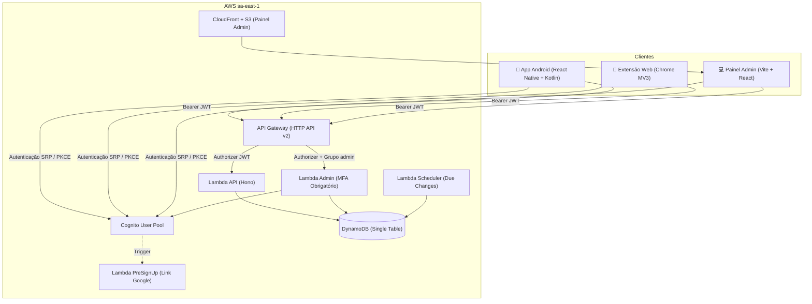

# Block Apps

Bloqueador de aplicativos (Android) e sites (extensão Chrome/Edge) focado em foco e produtividade, com sincronização em nuvem e salvaguardas contra desinstalação ou burla.

Toda a infraestrutura é construída na **AWS** (API Gateway HTTP, Lambda em ARM64, DynamoDB em tabela única, Cognito e CloudFront), provisionada integralmente via **Terraform**.

---

## Arquitetura



---

## Status dos Componentes

| Componente | Estado | Detalhes |
| --- | --- | --- |
| **Core (`packages/core`)** | ✅ Pronto | Regras de bloqueio, janelas de horário, palavras proibidas, cálculo de cooldown |
| **Backend (`packages/backend`)** | ✅ Pronto | Hono lambdalith, use cases, DynamoDB single-table, guardas administrativas |
| **Infraestrutura (`infra`)** | ✅ Pronto | 100% Terraform (auth, api, data, admin_site, bootstrap) |
| **Cliente de Dados (`packages/api`)** | ✅ Pronto | `HttpApiClient` com auto-refresh, `CognitoAuthenticator` com SRP e PKCE |
| **Extensão Chrome (`apps/extension`)** | ✅ Pronto | Declarative Net Request, palavras de busca proibidas, Google PKCE, anti-anônimo |
| **App Android (`apps/mobile`)** | ✅ Pronto | React Native + Módulo Kotlin, sincronização em segundo plano (`expo-background-task`), Device Admin |
| **Painel Web (`apps/admin`)** | ✅ Pronto | Gestão de usuários, MFA TOTP obrigatório para admins, Hosted UI Google |
| **CI/CD (`.github/workflows`)** | ✅ Pronto | GitHub Actions com testes, typecheck, validação Terraform e release |
| **App iOS** | ⏸️ Pausado | Aguarda conta Apple Developer e entitlement Family Controls |
| **Extensão Firefox** | ⏳ Planejado | Adaptação para Gecko via webextension-polyfill |

---

## Como Funciona

### 1. Cooldown de Segurança
Para impedir mudanças impulsivas, regras ativas não podem ser removidas ou afrouxadas instantaneamente.
- Solicitações de alteração ou remoção entram em um período de espera configurável por usuário (padrão de 24h).
- O `EventBridge Scheduler` executa a cada 5 minutos aplicando alterações cujo prazo expirou.

### 2. Autenticação e MFA
- **Usuários comuns:** cadastro aberto, login por e-mail/senha ou Google via Hosted UI com PKCE.
- **Administradores:** recebem convite do Cognito com senha temporária (`FORCE_CHANGE_PASSWORD`).
- **MFA Obrigatório para Admins:** acesso a rotas administrativas (`/admin/*`) exige autenticação TOTP ativa (`AdminCallerGuard`).

### 3. Bloqueio Offline e Anti-Burla
- Clientes realizam cache local das regras (`chrome.storage.local` na extensão e `SharedPreferences` do módulo nativo no Android).
- Mesmo sem conexão ou se o usuário fizer logout, as regras locais continuam ativas para evitar burlas.
- No Android, o módulo nativo com `DeviceAdmin` mantém as regras salvas no aparelho e uma tarefa em segundo plano as atualiza mesmo com o app fechado.

---

## Estrutura do Monorepo

```
block-apps/
├── packages/
│   ├── core/         # Regras de negócio, catálogo de apps, busca e horários
│   ├── api/          # Cliente HTTP, adaptadores Cognito, SessionStorage e Poller
│   └── backend/      # Handlers Lambda, Hono app, DynamoDB stores e use cases
├── apps/
│   ├── extension/    # Extensão Chrome/Edge (Manifest V3)
│   ├── admin/        # Painel web administrativo (React + Vite)
│   └── mobile/       # Aplicativo Android (React Native + Módulo Kotlin)
├── infra/            # Infraestrutura como Código (Terraform)
│   ├── bootstrap/    # S3 bucket para estado remoto
│   ├── modules/      # Módulos reutilizáveis (auth, api, data, admin_site)
│   └── environments/ # Ambiente dev
└── docs/             # Documentações detalhadas de arquitetura e infra
```

---

## Como Executar Localmente

### Testes e Validação
```powershell
pnpm install
pnpm check:no-any
pnpm typecheck
pnpm test
```

### Backend e DynamoDB Local
```powershell
docker compose -f docker-compose.backend.yml up -d
$env:DYNAMODB_ENDPOINT = "http://127.0.0.1:8000"
pnpm test
```

Para subir a API Hono localmente em `http://127.0.0.1:3000`:
```powershell
docker compose -f docker-compose.local.yml up -d --build
```

### Painel Administrativo
```powershell
pnpm --filter @block-apps/admin dev
```

### Extensão do Chrome
```powershell
pnpm --filter @block-apps/extension build
```
Carregue a pasta `apps/extension/dist` em `chrome://extensions`.

---

## Documentação

- [Arquitetura de Backend](docs/BACKEND.md)
- [Infraestrutura e Terraform](docs/INFRA.md)
- [Guia de Desenvolvimento Local](docs/LOCAL.md)
- [Histórico da Migração AWS](docs/AWS_MIGRATION.md)
- [Convenções de Código](docs/CONVENTIONS.md)
- [Roadmap do Projeto](docs/ROADMAP.md)
- [Comandos Executados na AWS](docs/AWS_COMMANDS_RUN.md)
