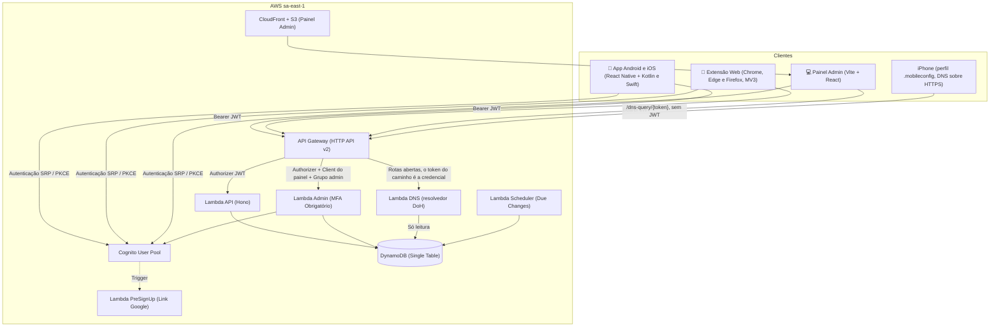

# Block Apps

Bloqueador de aplicativos (Android e iOS) e sites (extensão Chrome/Edge/Firefox e, no iPhone, também por DNS) focado em foco e produtividade, com sincronização em nuvem e salvaguardas contra desinstalação ou burla. O iOS está em validação (veja a tabela de status).

Toda a infraestrutura é construída na **AWS** (API Gateway HTTP, Lambda em ARM64, DynamoDB em tabela única, Cognito e CloudFront), provisionada integralmente via **Terraform**.

---

## Arquitetura



---

## Status dos Componentes

| Componente | Estado | Detalhes |
| --- | --- | --- |
| **Core (`packages/core`)** | ✅ Pronto | Regras de bloqueio, janelas de horário, palavras proibidas, cálculo de cooldown, decisão de mudança que só aperta o bloqueio, alvos do iOS |
| **Backend (`packages/backend`)** | ✅ Pronto | Hono lambdalith, use cases, DynamoDB single-table, guardas administrativas, cota de regras por usuário, aperto de regra aplicado na hora, perfil de DNS e resolvedor DoH |
| **Infraestrutura (`infra`)** | ✅ Pronto | 100% Terraform (auth, api, data, admin_site, lambda_function, bootstrap), inclusive a Lambda `dns`, as rotas abertas e os alarmes do resolvedor. O domínio e o certificado do `dns_host` ficam fora do Terraform ([docs/INFRA.md](docs/INFRA.md)) |
| **Cliente de Dados (`packages/api`)** | ✅ Pronto | `HttpApiClient` com auto-refresh, `CognitoAuthenticator` com SRP e PKCE |
| **Extensão Chrome/Edge (`apps/extension`)** | ✅ Pronto | Declarative Net Request, palavras de busca proibidas, Google PKCE, anti-anônimo |
| **App Android (`apps/mobile`)** | ✅ Pronto | React Native + Módulo Kotlin, sincronização em segundo plano (`expo-background-task`), Device Admin; palavras de busca só cadastradas (aplicação nativa pendente, veja `docs/ROADMAP.md`) |
| **Painel Web (`apps/admin`)** | ✅ Pronto | Gestão de usuários, MFA TOTP obrigatório para admins |
| **CI/CD (`.github/workflows`)** | ✅ Pronto | GitHub Actions com testes, typecheck, validação Terraform, build iOS e release |
| **App iOS (`apps/mobile`)** | 🚧 Em validação | Módulo Swift, extensões, grupos de apps e modo estrito opcional escritos e compilados em CI; falta entitlement Family Controls e teste em aparelho ([docs/IOS.md](docs/IOS.md)) |
| **Bloqueio de sites por DNS no iPhone** | 🚧 Só o servidor | Backend e Terraform prontos (`POST /dns/profile`, `GET /dns/profile.mobileconfig`, `/dns-query/{token}`). Nenhum cliente chama essas rotas ainda, e o domínio com certificado do `dns_host` é criado à parte |
| **Extensão Firefox** | 🟡 Implementado, falta publicar | `pnpm --filter @block-apps/extension build:firefox`; sem polyfill, o Firefox aceita `chrome.*` com Promises |

---

## Por onde começar

Três caminhos curtos, cada um percorre um fluxo inteiro, arquivo a arquivo. Leia na ordem. Regras de pasta e de código em [docs/CONVENTIONS.md](docs/CONVENTIONS.md).

### Backend: criar uma regra (`POST /rules`)

1. `packages/backend/src/lambda/apiHandler.ts`: entrada da Lambda `api`. Monta stores, use cases e o app Hono.
2. `packages/backend/src/http/app/createApiApp.ts`: exige o usuário autenticado em `/rules/*` (`requireAuthenticatedUser`) e monta as rotas.
3. `packages/backend/src/http/routes/createRulesRoutes.ts`: o `POST /` lê o corpo (`parseNewRuleBody`) e chama o caso de uso.
4. `packages/backend/src/rules/use-cases/CreateBlockRuleUseCase.ts`: normaliza o alvo, valida o conteúdo, confere a cota de regras e grava.
5. `packages/backend/src/rules/contracts/BlockRuleStore.ts`: o contrato de armazenamento que o caso de uso conhece.
6. `packages/backend/src/storage/dynamodb/rules/DynamoBlockRuleStore.ts`: a implementação em DynamoDB (`insert`).
7. `packages/backend/src/composition/createApiUseCases.ts` e `createDynamoStores.ts`: onde o caso de uso e o store são ligados.
8. `packages/backend/tests/api/rules.test.ts`: o teste da rota, contra banco em memória (e contra o DynamoDB local quando `DYNAMODB_ENDPOINT` existe).

### App: sincronizar as regras no celular

1. `apps/mobile/App.tsx`: `Root` chama `useSyncWhenAppIsActive` e `useBackgroundRulesSync`; `createServices` monta as dependências.
2. `apps/mobile/src/services/createServices.ts`: junta repositórios, bloqueador da plataforma e `AppRulesSync`.
3. `apps/mobile/src/adapters/createMobileServices.ts`: cria a sessão Cognito, o `HttpApiClient` e os repositórios HTTP de `packages/api`.
4. `apps/mobile/src/hooks/session/useSyncWhenAppIsActive.ts`: dispara a sincronização ao abrir o app e ao voltar ao primeiro plano.
5. `apps/mobile/src/sync/AppRulesSync.ts`: `sync()` aplica mudanças vencidas, lê regras e pendências e entrega ao bloqueador.
6. `packages/api/src/repositories/http/rules/HttpBlockRuleRepository.ts`: `list()` faz `GET /rules` pelo `HttpApiClient`.
7. `apps/mobile/src/ports/blocker/BlockerPort.ts`: a porta que `AppRulesSync` usa (`applyRules`).
8. `apps/mobile/src/adapters/blocker/createPlatformAdapters.ts`: escolhe o adaptador Android ou iOS; no Android, `android/AndroidBlockerAdapter.ts` serializa com `android/rules/toNativeRulesJson.ts` e chama `setRules` no módulo.
9. `apps/mobile/modules/app-blocker/src/AppBlockerModule.ts`: a ponte TypeScript. O lado nativo é `android/src/main/java/expo/modules/appblocker/AppBlockerModule.kt` e `ios/AppBlockerModule.swift`.
10. Em segundo plano: `apps/mobile/index.ts` importa `src/background/defineRulesSyncTask.ts`, que roda `syncRulesInBackground`. O agendamento vem de `useBackgroundRulesSync` e `RulesSyncScheduler`.

### Infra: de uma rota até a Lambda

1. `infra/environments/dev/main.tf`: o ambiente que liga os módulos; `module "api"` recebe tabela, Cognito e `lambda_zip_path`.
2. `infra/modules/api/gateway.tf`: a HTTP API, os dois authorizers JWT (`cognito` e `cognito_admin`) e o stage.
3. `infra/modules/api/routes.tf`: as rotas. `ANY /{proxy+}` (JWT) leva tudo que não tem rota própria, inclusive `POST /rules`, à integração da Lambda `api`; `/admin/{proxy+}` e `/dns-query/{token}` têm rota e permissão de invocação próprias.
4. `infra/modules/api/functions.tf`: as funções. `module "api_function"` usa o handler `index.apiHandler` e as variáveis `TABLE_NAME`, `MAX_RULES_PER_USER` e `DNS_HOST`.
5. `infra/modules/api/permissions.tf`: o que cada função pode fazer no DynamoDB.
6. `infra/modules/lambda_function/main.tf`: o módulo que cria a função, a role, os logs e o tracing.
7. `packages/backend/scripts/packageLambda.mjs` e `packages/backend/src/index.ts`: geram o `lambda.zip` com `apiHandler`, `adminHandler`, `dnsHandler`, `preSignUpHandler` e `schedulerHandler`.

---

## Como Funciona

### 1. Cooldown de Segurança
Para impedir mudanças impulsivas, regras ativas não podem ser removidas ou afrouxadas instantaneamente.
- Solicitações de alteração ou remoção entram em um período de espera configurável por usuário (padrão de 24h).
- Mudança que só aperta o bloqueio vale na hora: trocar "só em janelas" por "sempre bloqueado", ou reduzir as janelas permitidas (as novas precisam caber dentro das atuais). O que afrouxa, ou aperta e afrouxa ao mesmo tempo, espera o cooldown.
- O `EventBridge Scheduler` executa a cada 5 minutos aplicando alterações cujo prazo expirou.

### 2. Autenticação e MFA
- **Usuários comuns:** cadastro aberto, login por e-mail/senha ou Google via Hosted UI com PKCE.
- **Administradores:** recebem convite do Cognito com senha temporária (`FORCE_CHANGE_PASSWORD`).
- **MFA Obrigatório para Admins:** acesso a rotas administrativas (`/admin/*`) exige autenticação TOTP ativa (`AdminCallerGuard`).

### 3. Bloqueio Offline e Anti-Burla
- Clientes realizam cache local das regras (`chrome.storage.local` na extensão, `SharedPreferences` do módulo nativo no Android e o App Group no iOS).
- Mesmo sem conexão ou se o usuário fizer logout, as regras locais continuam ativas para evitar burlas.
- No Android, o módulo nativo com `DeviceAdmin` mantém as regras salvas no aparelho e uma tarefa em segundo plano tenta atualizá-las com intervalo mínimo de 15 minutos. O Android decide quando ela roda (Doze, otimização de bateria) e a tarefa não roda se o usuário forçar a parada do app; por isso a sincronização também acontece ao abrir o app e ao voltar ao primeiro plano.
- No iOS, o bloqueio usa a Screen Time API e falha fechado: o padrão é bloqueado e tudo é recalculado a partir das regras salvas. Detalhes em [docs/IOS.md](docs/IOS.md).

### 4. Bloqueio de sites por DNS no iPhone
O usuário cria o perfil com `POST /dns/profile` (devolve um token), baixa `GET /dns/profile.mobileconfig` com o JWT e instala o perfil no iOS. O iPhone passa a consultar `https://<DNS_HOST>/dns-query/<token>`, atendido pela Lambda `dns` sem JWT (o token do caminho é a credencial). Sites das regras `site` do usuário são bloqueados; o resto vai a um resolvedor público. O perfil não é assinado e pode ser removido pelo usuário. Detalhes em [docs/BACKEND.md](docs/BACKEND.md) e [docs/INFRA.md](docs/INFRA.md). Os apps ainda não chamam essas rotas.

---

## Estrutura do Monorepo

```
block-apps/
├── packages/
│   ├── core/         # Regras de negócio, catálogo de apps, busca e horários
│   ├── api/          # Cliente HTTP, adaptadores Cognito, SessionStorage e Poller
│   └── backend/      # Handlers Lambda, Hono app, DynamoDB stores, use cases e resolvedor DNS
├── apps/
│   ├── extension/    # Extensão Chrome/Edge/Firefox (Manifest V3)
│   ├── admin/        # Painel web administrativo (React + Vite)
│   └── mobile/       # Aplicativo Android e iOS (React Native + módulos Kotlin e Swift)
├── infra/            # Infraestrutura como Código (Terraform)
│   ├── bootstrap/    # S3 bucket para estado remoto
│   ├── modules/      # Módulos reutilizáveis (auth, api, data, admin_site, lambda_function)
│   └── environments/ # Ambiente dev
├── scripts/          # checkNoExplicitAny.mjs (pnpm check:no-any)
└── docs/             # Documentações detalhadas de arquitetura e infra
    └── history/      # Histórico da migração para a AWS
```

Cada pacote tem o seu README: [core](packages/core/README.md), [api](packages/api/README.md), [backend](packages/backend/README.md), [admin](apps/admin/README.md), [extension](apps/extension/README.md), [mobile](apps/mobile/README.md) e [infra](infra/README.md).

---

## Como Executar Localmente

### Testes e Validação
```powershell
pnpm install
pnpm check:no-any
pnpm typecheck
pnpm test
```

### Backend e DynamoDB Local
```powershell
docker compose -f docker-compose.backend.yml up -d
$env:DYNAMODB_ENDPOINT = "http://127.0.0.1:8000"
pnpm test
```

Para subir a API Hono localmente em `http://127.0.0.1:3000`:
```powershell
docker compose -f docker-compose.local.yml up -d --build
```

### Painel Administrativo
```powershell
pnpm --filter @block-apps/admin dev
```

### Extensão do Chrome
```powershell
pnpm --filter @block-apps/extension build
```
Carregue a pasta `apps/extension/dist` em `chrome://extensions`.

### Extensão do Firefox
```powershell
pnpm --filter @block-apps/extension build:firefox
```
Carregue `apps/extension/dist-firefox/manifest.json` em `about:debugging#/runtime/this-firefox`. Detalhes, login Google e publicação em [apps/extension/README.md](apps/extension/README.md).

---

## Documentação

- [Arquitetura de Backend](docs/BACKEND.md)
- [Infraestrutura e Terraform](docs/INFRA.md)
- [Guia de Desenvolvimento Local](docs/LOCAL.md)
- [iOS (Screen Time API)](docs/IOS.md)
- [Pedido do entitlement Family Controls](docs/IOS_ENTITLEMENT_REQUEST.md)
- [Convenções de Código](docs/CONVENTIONS.md)
- [Roadmap do Projeto](docs/ROADMAP.md)

`docs/history/` guarda registros do passado (migração para a AWS e comandos executados). É histórico, não referência: pode estar desatualizado.
